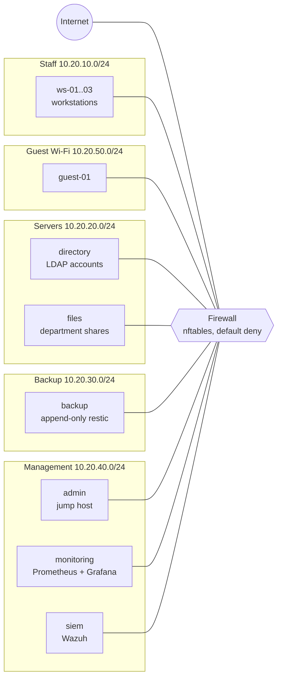

# Small Office Infrastructure as Code

The complete IT setup for **Kestrel Studio**, a fictional 20-person architecture
studio, built and tested with code: network segments and a firewall, central
accounts, backups, monitoring and a SIEM. One command builds it on a laptop.
Another proves it works.

> **Everything here is fictional.** The company, its staff and its documents are
> made up. The domain is `kestrel.test`, which is reserved and can never be real.



Every machine sits in one segment, and the only way between segments is the
firewall. It forwards just the flows listed in
[`policy/network.yml`](policy/network.yml) and logs everything else to the SIEM.

## What's in it

| Area | What it does | Where |
|---|---|---|
| **Network** | 5 segments plus internet, default-deny firewall generated from a policy file, NAT for staff and guests | [policy/network.yml](policy/network.yml), [firewall role](ansible/roles/firewall) |
| **Identity** | Central directory (LDAP) built from a staff roster. Joiners, movers and leavers are a YAML change. Grafana logins and roles come from directory groups. | [policy/people.yml](policy/people.yml), [directory role](ansible/roles/directory) |
| **Admin access** | One jump host with an SSH key. Password logins disabled everywhere. | [admin role](ansible/roles/admin_jumphost), [ssh role](ansible/roles/ssh_server) |
| **Backups** | Nightly encrypted restic backups to an **append-only** server, so ransomware can't delete them. Retention runs on the backup server only. Restores are tested automatically. | [backup roles](ansible/roles) |
| **Monitoring** | Prometheus checks every service through the firewall. Alerts for services that are down and backups that are failing or too old. Grafana dashboard. | [config/monitoring](config/monitoring) |
| **SIEM** | Wazuh receives logs from every machine. Detections: guest network probing inside, port scans, SSH brute force, failed backups. | [config/siem](config/siem) |
| **Runbooks** | What staff and IT do when something breaks | [docs/runbooks](docs/runbooks) |

## Quick start

Needs Docker (Docker Desktop on a Mac with 8 GB assigned to it is plenty), Terraform 1.6+,
Ansible 2.16+ and Python 3.

```bash
make up      # build networks, machines and services, then configure them
make test    # check every firewall path, login, backup, alert and detection
make demo    # simulated attacks, then what the SIEM caught
make down    # remove the lab
```

Then open Grafana at <http://127.0.0.1:3000> and log in as an IT admin, e.g.
`riyer`, with the password from `make password U=riyer`. Log in as `atanaka` (a
designer) to see the read-only view.

## How it works

**Terraform** builds what exists: the network segments, every machine and its
address, the service containers and the generated secrets. **Ansible** configures
what runs inside: firewall rules, accounts, SSH, backup jobs and log forwarding.
Both read the same policy files, so the IP plan, the allowed flows and the staff
list each live in exactly one place.

| Command | Takes | What changes |
|---|---|---|
| `make up` | 3-5 min | Everything, from nothing |
| `make configure` | ~1 min | Re-applies all configuration (safe to repeat) |
| `make users` | ~15 s | Applies roster changes only |

## The tests

`make test` runs about 240 checks against the live lab:

- **Segmentation:** every pair of zones, on every port the policy mentions plus
  ones an attacker would try, either allowed or blocked exactly as the policy says.
- **No bypass:** no process on any machine can change its own routing to get
  around the firewall.
- **Identity:** everyone on the roster can log in, nobody else exists, a wrong
  password fails, Grafana roles follow directory groups, and a leaver loses access.
- **Backups:** backups run and report, a restore matches the live data byte for
  byte, a client can't delete its own backups, and it can't read anyone else's.
- **Monitoring:** every service check is up and every alert rule is loaded.
- **SIEM:** logs arrive, and each detection fires on a real simulated attack.

CI runs the same suite on every push: it builds the whole office, tests it and
tears it down.

## Design documents

- [Architecture](docs/architecture.md): segments, IP plan, flows, data paths
- [Threat model](docs/threat-model.md): what this protects against, and what it doesn't
- [Design decisions](docs/adr/): including [why Docker's "internal" networks don't work for this](docs/adr/0002-docker-networking.md)
- [Runbooks](docs/runbooks/): onboarding, offboarding, restore, alert triage, service down, compromised workstation
- [Cloud mapping](docs/cloud-mapping.md): how each piece would look on AWS
- [Roadmap](docs/roadmap.md): what I would improve next

## Transparency

Parts of this repository were written with an AI assistant. See
[AI_USAGE.md](AI_USAGE.md) for exactly which files and how.

## License

[MIT](LICENSE)
