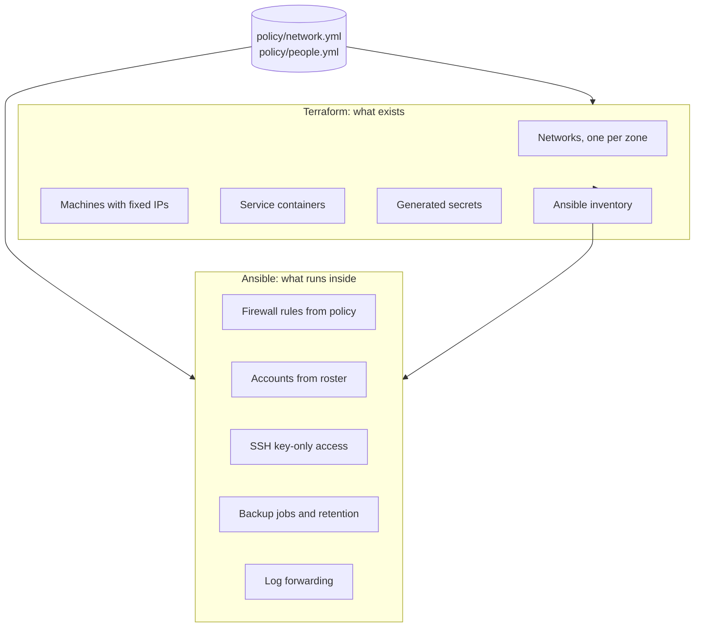

# Architecture

## The organisation

Kestrel Studio (fictional): 20 people in one office. Leadership, designers,
project managers, finance and HR, office staff, and two IT admins. They need
email-style accounts, shared folders per department, internet access, guest
Wi-Fi for clients, and confidence that a stolen laptop or ransomware is not
a disaster.

## Requirements

| # | Requirement | How it's met |
|---|---|---|
| R1 | Staff can reach what their job needs, and nothing else | Segmentation + default-deny firewall |
| R2 | Visitors get internet, never the office network | Guest segment, internet-only flows, alert on any attempt inside |
| R3 | One account per person, removed the day they leave | Directory generated from the roster; leavers deleted on the next run |
| R4 | Losing a server, or ransomware, doesn't lose data | Nightly encrypted, append-only backups with tested restores |
| R5 | IT knows when something is down or failing | Service checks, backup metrics, alert rules, dashboard |
| R6 | Suspicious activity is noticed | All logs to a SIEM, detections for the likely attacks |
| R7 | Rebuildable by someone else | Everything in code, one command to build, one to test |

## Segments and IP plan

| Zone | Subnet | Hosts | Purpose |
|---|---|---|---|
| staff | 10.20.10.0/24 | ws-01 .11, ws-02 .12, ws-03 .13 | Employee workstations |
| servers | 10.20.20.0/24 | directory .10, files .20 | Accounts, file shares |
| backup | 10.20.30.0/24 | backup .10 | Backup storage only |
| mgmt | 10.20.40.0/24 | admin .5, monitoring .10, siem .20 | IT tools |
| guest | 10.20.50.0/24 | guest-01 .11 | Visitor Wi-Fi |
| (uplink) | 10.20.0.0/24 | firewall .2 | Firewall's internet side (NAT) |

The firewall is `.254` in every zone and is every machine's default gateway.
All of this comes from [`policy/network.yml`](../policy/network.yml).

## Allowed flows

Everything not in this table is dropped and logged.

| From | To | Ports | Why |
|---|---|---|---|
| staff | servers | 3890/tcp | Directory logins |
| staff | internet | 80, 443/tcp, 53/udp | Web |
| staff | mgmt | 514/udp | Logs to SIEM |
| guest | internet | 80, 443/tcp, 53/udp | Guest internet only |
| servers | backup | 8000/tcp | Backups |
| servers | mgmt | 514/udp, 9091/tcp | Logs, backup metrics |
| backup | mgmt | 514/udp | Logs |
| mgmt | servers | 22, 3890, 17170/tcp | Admin, health checks, Grafana logins |
| mgmt | backup | 8000/tcp | Health checks |
| mgmt | staff | 22/tcp | Workstation support |
| mgmt | internet | 443/tcp, 53/udp | Updates |

Things worth noticing:

- **Servers have no internet access.** Malware on the file server can't download
  tools or send data out.
- **Nothing can reach the backup segment except backup traffic.** Not even staff.
- **Logs flow towards mgmt; management flows away from it.** Nothing outside
  mgmt can open a connection to the admin tools.

## Components

| Machine | Runs | Notes |
|---|---|---|
| fw | nftables, ulogd, rsyslog | Rules generated from policy; fails closed on boot |
| directory | lldap | LDAP for logins; web UI for admins only |
| files | sshd, department shares, restic | Sample fictional documents |
| backup | rest-server (append-only), restic for pruning | Only reachable on 8000 from servers/mgmt |
| admin | SSH client with the only admin key | The one way to administer servers and workstations |
| monitoring | Prometheus, Grafana, blackbox exporter, Pushgateway | Published to 127.0.0.1 only (stands in for admin VPN) |
| siem | Wazuh manager | Syslog in, alerts out |

Third-party services (lldap, rest-server, Prometheus, Grafana, Wazuh) run in their
host machine's network namespace. They have that host's IP address, and the
firewall policy applies to them exactly as to any other process there.

## Key data paths

**Login.** A workstation binds to LDAP on `directory:3890` (staff → servers).
Grafana, on monitoring, binds with a read-only service account (mgmt → servers)
and maps the `it-admins` group to Admin and `all-staff` to Viewer.

**Backup.** At 01:15 each server runs restic against `backup:8000` with its own
login. Data is encrypted on the client. The server only accepts new data
(append-only), and each client can only see its own repository. The result is
pushed to Pushgateway (servers → mgmt:9091) and logged to syslog. Retention runs
on the backup server every Sunday, directly on the disk, never from a client.

**Logs.** Every machine runs rsyslog and forwards to `siem:514/udp`. The
firewall logs dropped packets with nftables → ulogd → syslog, tagged with the
source zone. Wazuh decodes them with [custom decoders](../config/siem/local_decoder.xml)
and applies [custom rules](../config/siem/local_rules.xml) on top of its built-in ones.

## Design decisions

See [`docs/adr/`](adr/):

1. [Terraform builds, Ansible configures, policy files drive both](adr/0001-terraform-ansible-split.md)
2. [Docker networking: why not "internal" networks, and how hosts can't bypass the firewall](adr/0002-docker-networking.md)
3. [Append-only backups with retention on the server side](adr/0003-append-only-backups.md)
4. [The staff roster is the source of truth for accounts](adr/0004-roster-as-code.md)
5. [Wazuh over syslog, no agents](adr/0005-siem-over-syslog.md)
